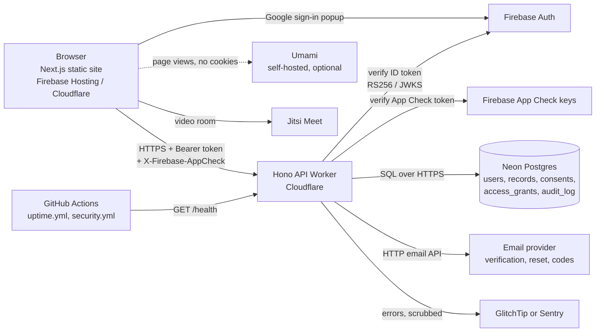

# MediCare — free & open-source integrations

Branch `feature/open-source-integrations`. Nothing here is deployed or applied to production until you approve it.
This page is the architecture, the honest verdict on every requested service, and the full list of costs that cannot be avoided.

> **Not a compliance claim.** Nothing in this repository is certified for HIPAA, India's DPDP Act, or any other regime, and no
> clinical decision-making feature exists. These controls reduce risk; they do not make the service compliant. Get a qualified
> review before handling real patient data at scale.

## Architecture

Request path protections, in order: CORS allow-list → Origin (CSRF) guard → App Check (when enforced) → per-IP rate limit →
token/session check (revocable, versioned) → role (RBAC) → per-record ownership or patient-granted access → audit row.

## Verdict per requested service

| Area | Service | Status | Notes |
|---|---|---|---|
| Auth | Firebase Auth (Google) | **Integrated** (earlier) | Server verifies every ID token. |
| Auth | Email + password, verification, reset | **Integrated** (earlier) | bcrypt in Postgres, single-use hashed tokens. |
| Auth | **Email one-time code** | **Integrated + tested** | 6 digits, HMAC-hashed, 10 min, 5 attempts, single use, not offered to MFA accounts. |
| Auth | TOTP two-step + recovery codes | **Integrated** (earlier) | |
| Auth | SMS OTP via TextBee | **Not built** | Needs a phone-verification flow plus an Android phone/SIM acting as the gateway; SMS carrier cost. Add later as an adapter if wanted. |
| Auth | SuperTokens / Authgear / Keycloak | **Not integrated** | Would duplicate the working Firebase + own-JWT stack and need a server. No benefit now. |
| Security | **ALTCHA** | **Integrated + tested** | Self-hosted PoW; on register, forgot-password, email-code request. Off until `CAPTCHA_SECRET` is set. |
| Security | **Firebase App Check** | **Integrated + tested** (server) | Free. Needs your reCAPTCHA v3 key; enforcement is a switch (`APPCHECK_ENFORCE`). |
| Security | Firestore / Storage rules | **Added (deny-all)** | The app does not use either; rules guarantee nothing is exposed if enabled later. |
| Security | **RBAC** | **Integrated + tested** | `patient` / `doctor`; roles settable only by an administrator; users cannot self-promote. |
| Security | API rate limiting | **Integrated** (earlier) | Cloudflare binding + durable per-account/IP throttles in Postgres. |
| Security | **Audit logs for record access** | **Integrated + tested** | Owner list/read, doctor reads (logged for doctor *and* visible to patient), denials, grants, exports. IDs/counts only — never content. |
| Healthcare | **Consent records** | **Integrated + tested** | Append-only history; withdrawing `doctor_sharing` ends all doctor access immediately. |
| Healthcare | **Doctor access with patient authorisation** | **Integrated + tested** | Needs role + unexpired, unrevoked grant for the scope + live consent, checked on every read. |
| Healthcare | **FHIR R4 export** | **Integrated + tested (shape)** | Patient's own data as a Bundle (Patient, Condition, AllergyIntolerance, MedicationStatement, Observation), uncoded free text. Not validated against a FHIR server; for portability only. |
| Healthcare | Medplum | **Not integrated** | A full FHIR server (Node + Postgres + Redis) to host and secure; overlaps the existing database. Revisit if you need FHIR exchange with hospitals. |
| Healthcare | Appointments, prescriptions, secure document storage | **Not built** | Documents need private object storage (Cloudflare R2 is not enabled on your account) and clinical/regulatory design; prescriptions are regulated. Deliberately not improvised. |
| Comms | Jitsi | **Already used** (public `meet.jit.si`) | Free but not private/branded; see costs. |
| Comms | SMTP email | **Integrated via HTTP email API** | Workers cannot open SMTP sockets. Any provider with a Resend-style JSON API works (`EMAIL_API_URL`). |
| Monitoring | Sentry-compatible errors → **GlitchTip** | **Ready** | Set `SENTRY_DSN` to a GlitchTip DSN. Events are scrubbed (bodies, cookies, headers, query, user). |
| Monitoring | **Umami** | **Integrated** (off by default) | Cookieless, Do-Not-Track honoured, no identifiers or health data sent. Needs a server (see costs) and a CSP entry. |
| Monitoring | **Uptime** | **Integrated** | `.github/workflows/uptime.yml` every 30 min (best-effort). Uptime Kuma is the self-hosted upgrade. |
| Other | Appwrite, PocketBase, MinIO, HCW@Home, ICTHospital | **Not integrated** | Each is a backend/server that would replace or duplicate Neon + Workers; no gap they fill today. |

## Costs you cannot avoid (₹0 licences ≠ ₹0 running cost)

| Item | Needed for | Cost |
|---|---|---|
| Server for self-hosted tools (Umami, GlitchTip, Uptime Kuma, Jitsi) — Coolify, Dokploy, CapRover, Dokku etc. are free *software* but need a machine | Analytics, error tracking, uptime, private video | A VPS (roughly a few hundred ₹/month and up). Some clouds offer an always-free VM, but availability and terms change — verify before relying on it. |
| Email provider | Verification, reset, sign-in codes | Free tiers exist (provider-dependent daily/monthly caps); the providers themselves are not open source. Needs a domain you own for deliverability. |
| Domain name | Branded email sender, custom site URL | Yearly registration fee. |
| SMS (if TextBee/any SMS added) | SMS OTP | An Android phone + SIM + your carrier's per-SMS charges. |
| Neon / Cloudflare Workers / Firebase Hosting | Core platform | Free tiers today; paid when limits are exceeded (Workers free plan is 10 ms CPU/request — bcrypt runs in Postgres for that reason). |
| Private file storage (R2 or similar) | Secure patient documents (not built) | Free tier then pay-as-you-go; Cloudflare may require a payment method on file. |
| Compliance review / legal | Real patient data | Professional fees; none of this repo replaces it. |
| Jitsi privacy | Private consultations | Public `meet.jit.si` is free but not confidential. Self-host Jitsi (server cost) or use JaaS with JWT (paid beyond a free allowance). |

## Where things are

- Worker: `workers/api/src/{captcha,appcheck,scrub,audit}.ts`, `routes/{care,account,admin}.ts`, `migrations/004_open_source_integrations.sql`
- Website: `lib/{captcha,appcheck}.ts`, `components/{Analytics.tsx,auth/EmailAuthForm.tsx}`
- Rules/config: `frontend/{firestore,storage}.rules`, `frontend/firebase.json`, `.env.integrations.example`, `.github/workflows/uptime.yml`
- Setup: [SETUP.md](SETUP.md) · Tests: [TESTING.md](TESTING.md) · Security reports: [../security](../security)
